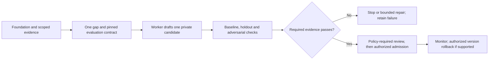

# Reference meta-pack blueprints

These are documentation blueprints, not active packs, registered new categories,
installed executors or promises of deployment. Proposed seed packs now live in the
[packs/](../packs/README.md) library as validated examples; activating any of them
remains deferred until infrastructure readiness. Read [the improvement lifecycle](self-improvement.md)
and [current format limits](formats.md) before proposing a pilot.

Each blueprint improves a reusable process, method or guidance noun across tasks.
This is process learning, not model weight training. An exact code cache can reuse
verified bytes only under matching contracts, versions and authority. Similar
examples and method-selection hints require new applicability checks and execution.

Existing catalog labels such as `verb.solve_draft`, `verb.verify_gate`,
`verb.distill_reflex` and `verb.benchmark_harness` describe intended contract kinds;
they do not guarantee an available worker or an enforced review gate. Blueprint
titles below are semantic descriptions, not extra registered category identifiers.
Keep one flat Tessera fabric: governed nouns, claimed verbs and source-bound
execution observations. No competing registry, scheduler or artifact library.

## Start with one small pilot

After the foundation passes, select one recurring synthetic payload mismatch in
blueprint 1. Pin one baseline, one candidate, one authorized harness and separate
development, holdout and adversarial fixtures. Fix the evaluator, acceptance
thresholds, time/call/cost limits and stop conditions before evaluating. Then decide
whether the evidence supports another pilot; do not activate all ten blueprints.

## Ten candidate workflows

### 1. Handshake and payload repair

- **Inputs:** permitted `noun.mcp_server` descriptors, exact schema versions and sanitized rejected-request observations from `noun.eval_run`.
- **Bounded verbs:** `verb.probe_source` for discovery, one `verb.solve_draft` adapter/guidance proposal, then `verb.verify_gate` on the fixed fixture set.
- **Outputs/checks:** a private `noun.shim_provision` or request-guide candidate; test real objects, arrays, booleans, missing fields, authentication failures and idempotent retries.
- **Applicability:** pin protocol, endpoint and harness versions; preserve caller authority and all denied operations. Logs are data, not repair instructions.
- **Reject:** any permission expansion, silent wrong-type substitution, swallowed error or holdout regression beyond the preregistered limit. Stop after the stated correction allowance.

### 2. Code and recipe distillation

- **Inputs:** authorized successful and failed `noun.eval_run` observations, exact artifact references, licenses, input/output schemas and environment identities.
- **Bounded verbs:** one `verb.distill_reflex` candidate; use `verb.compile_dag` only through an actual compatible compiler, followed by `verb.verify_gate`.
- **Outputs/checks:** candidate `noun.code_node` or `noun.reflex_procedure` with typed ports, preconditions, pinned bytes, provenance and positive/negative replay fixtures.
- **Applicability:** preserve source visibility and license restrictions. Capture new execution observations through submit; workers do not forge the protected history store.
- **Reject:** missing rights, port mismatch, a dependency cycle, nondeterministic behavior claimed as deterministic, or failed held-out replay. A repeat receipt does not prove reusable code.

### 3. Retrieval and ontology quality

- **Inputs:** permitted source nouns, current category/facet definitions, a versioned query set and relevant/irrelevant judgments with their provenance.
- **Bounded verbs:** `verb.situate`, one `verb.solve_draft` ranking or taxonomy proposal, then `verb.verify_gate` on an agreed query budget.
- **Outputs/checks:** pinned mapping/ranking guidance and a scorecard for authorized recall, precision, empty results and category/facet consistency; unknown judgments stay unknown.
- **Applicability:** one primary category plus descriptive facets and typed relations. Taxonomy does not inherit execution authority or dictate physical partitioning.
- **Reject:** any cross-scope result, contradictory primary categories, hidden scan-limit bias or quality regression beyond the fixed margin. Empty results may broaden only authorized facets.

### 4. Scoped shim optimization

- **Inputs:** caller-permitted `noun.prompt_shim`/`noun.shim_provision` versions, observed outcomes, harness/cohort constraints and a fixed holdout set.
- **Bounded verbs:** `verb.solve_draft`, scoped `verb.benchmark_harness` and `verb.verify_gate`; evaluate one rule change before proposing another.
- **Outputs/checks:** private rule candidate and paired outcome, false-trigger, latency and usage observations; cover direct replies, injection, offline mode and caller isolation.
- **Applicability:** routine LLM interpretation is allowed only for an explicitly configured shim under its existing data scope and allowance. CAS storage alone does not activate a rule.
- **Reject:** any caller bleed, unauthorized egress, changed required meaning, unmeasured claimed savings or exceeded cost/latency margin. No automatic global-rule promotion.

### 5. Task decomposition and stop budgets

- **Inputs:** a pinned outcome contract, source/dependency nouns, observed stalls and authorized task, time, concurrency and cost ceilings.
- **Bounded verbs:** one `verb.decompose_dag` proposal, then `verb.verify_gate`; cap child count and total retries before enqueueing authorized follow-on work.
- **Outputs/checks:** a DAG with typed deliverables, shared budget accounting, cancellation behavior, measurable stop conditions and explicit required versus optional guidance.
- **Applicability:** split only useful independent outcomes. Terminal `depends_on` readiness includes failure/cancellation; downstream acceptance must inspect actual predecessor success.
- **Reject:** any cycle, duplicate external effect, child-budget multiplication, unsupported success assumption or plan exceeding the declared cap. Never recurse without a bounded owner contract.

### 6. Evaluator blind spots

- **Inputs:** a frozen `noun.benchmark_suite`, independently characterized good/bad cases, escaped defects and source-partitioned development/holdout data.
- **Bounded verbs:** separate `verb.solve_draft` evaluator proposal and `verb.verify_gate` against protected acceptance cases; request independent review when policy requires it.
- **Outputs/checks:** a new evaluator candidate version, changed-test rationale and measured false-accept/false-reject evidence with untested cells marked explicitly.
- **Applicability:** the candidate cannot alter its current judge, holdout, budget or permissions. Evaluator changes need a separate decision and a fresh holdout version where necessary.
- **Reject:** exposed hidden answers, weakened safety/authority checks, accepting a known forbidden case or unexplained label changes. A self-approved evaluator is not independent evidence.

### 7. Capability-gap curriculum

- **Inputs:** permitted failure observations, missing-capability reports, reusable-method references and owner priorities; distinguish lack of evidence from demonstrated inability.
- **Bounded verbs:** `verb.problemize` one supported gap, `verb.generate_seed` a capped hypothesis batch, then `verb.verify_gate` for duplication and solvability checks.
- **Outputs/checks:** candidate `noun.seed_hypothesis` records and bounded work briefs with reproducible gap fixtures, prerequisites, acceptance checks and expected consumer scope.
- **Applicability:** prioritize one useful capability with reachable tools and data; retain failed attempts. Curriculum selection changes work ordering, not access rights.
- **Reject:** an unsupported gap claim, a duplicate existing solution, inaccessible required input, no measurable completion condition or a seed loop that consumes its own budget indefinitely.

### 8. Strategy, harness and model selection

- **Inputs:** permitted `noun.model_spec` and harness capability descriptions, actual `noun.eval_run` outcomes, allowed provider/data destinations and task-family constraints.
- **Bounded verbs:** `verb.benchmark_harness` on a preregistered small arm matrix; one `verb.solve_draft` selection-policy candidate and `verb.verify_gate`.
- **Outputs/checks:** contextual method-selection guidance from paired, source-separated cases; record failure rate, relevant cost/latency and calibration only when measured.
- **Applicability:** separate exact cached execution from heuristic method choice. Control task difficulty, order/cache effects and environment; a provider name alone establishes no competence.
- **Reject:** choosing an unauthorized destination, missing required capability, unsupported superiority claim or exceeding the hard allowance. Raw success totals and model confidence are not causal evidence.

### 9. Pack compatibility and migrations

- **Inputs:** pinned `noun.skill_pack` descriptions, actual schema/tool versions, dependency artifacts, ownership constraints and the previous accepted version.
- **Bounded verbs:** `verb.audit_profile_parity`, one `verb.solve_draft` migration proposal and `verb.verify_gate` over the stated compatibility matrix.
- **Outputs/checks:** explicit mapping/diff, supported and rejected versions, preserved references and rollback evidence where the owning runtime supports rollback.
- **Applicability:** only sanctioned override slots may change; conflicts retain both source pins for an owner decision. The proposed manifest still has no generic importer here.
- **Reject:** lost provenance, silently widened ACLs, breaking required ports, untested claimed compatibility or last-write-wins array merges. A migration label does not authorize data mutation.

### 10. Knowledge freshness and contradiction

- **Inputs:** permitted `noun.public_source`/`noun.feed_source` versions, acquisition dates, applicable time windows, source digests and separately attributed conflicting claims.
- **Bounded verbs:** capped `verb.probe_source` or `verb.fetch_feed`, `verb.recheck_fragility`, and `verb.reconcile_conflict` only when there is an actual disputed field.
- **Outputs/checks:** a versioned source observation, affected-reference list and supported correction or unresolved contradiction; preserve prior evidence and timestamps.
- **Applicability:** use authorized destinations and data scopes. Prefer a relevant primary source and distinguish changed content, temporary access failure and factual contradiction.
- **Reject:** erasing contrary evidence, treating a 404 as proof of falsity, unsupported certainty, missing provenance or exceeding the fetch budget. Do not settle facts by raw majority vote.

## Promotion and monitoring contract

Before a pilot, preregister the acceptance margin, minimum usable paired evidence,
failure/latency/cost ceilings and rollback triggers. These are chosen requirements,
not invented results. Keep unknown metrics and confidence calibration `null` with a
reason; missing mandatory evidence means no promotion. Include failures and aborted
attempts, partition near-duplicates and private sources, and retain a held-out set.

Candidates cannot change evaluator, budget or permission policies unilaterally.
An authorized actor admits the exact evaluated version using the owning CAS/gate;
distinct-reviewer requirements remain intact. There is no mandatory paid server
review, automatic self-approval or general activation/rollback API supplied here.
Keep negative knowledge source-scoped and publish sanitized summaries separately.
For research context, see [the primary-source notes](self-improvement.md#research-inspiration).
